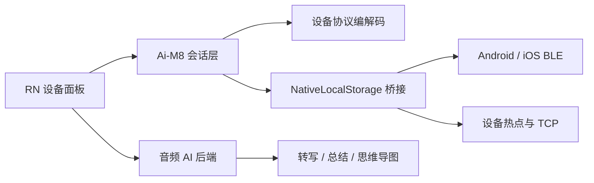

# DOIT Ai-M8 智能录音设备 RN 面板

Ai-M8 智能录音设备的 React Native 接入参考实现。项目通过宿主 App 提供的 BLE、Wi-Fi 和本地存储桥接能力，完成录音控制、设备文件管理、录音播放以及转写、总结和思维导图展示。

> 当前实现已在 Android 和 iOS 真机上完成基础功能验证。不同固件版本和宿主桥接实现可能存在差异，量产前必须使用目标设备完整回归。

## 项目定位

本仓库是可嵌入现有 React Native 宿主的业务子面板，不是可单独安装运行的 App，也不包含独立的 Android、iOS 或 Metro 工程。

| 项目 | 值 |
| --- | --- |
| 正式组件名 | `2026091513500001` |
| 调试组件名 | `AiNotePanel` |
| 设备 BLE Name | `Ai-M8` |
| 设备音频格式 | ADTS AAC |
| 主服务 UUID | `0000d0d0-0000-1000-8000-00805f9b34fb` |
| 写入特征 | `0000d0d1-0000-1000-8000-00805f9b34fb` |
| 控制通知特征 | `0000d0d3-0000-1000-8000-00805f9b34fb` |
| 文件通知特征 | `0000d0d4-0000-1000-8000-00805f9b34fb` |

## 已实现能力

- 查询电量、充电状态、存储容量、固件版本和录音状态
- 开始、暂停、继续和停止录音
- 响应设备实体按键产生的录音状态通知
- 查询、筛选和管理设备录音文件
- 文件夹、回收站和本地文件管理
- 通过 BLE 下载、取消和删除设备文件
- 连接设备热点并通过 TCP 进行 Wi-Fi 快传
- 播放下载到手机的 AAC 录音
- 配置降噪等级和录音分段时长
- 设备名称动态更新和设备持久化
- 上传录音并展示转写、AI 总结和思维导图

默认不会在下载后删除设备文件。用户显式开启“下载后清理设备”后，才会执行设备端删除。

## 架构



核心目录：

```text
.
├── App.tsx                       # 页面、录音和文件管理交互
├── index.js                      # RN 组件注册入口
├── specs/NativeLocalStorage.ts   # 宿主 TurboModule 契约
├── src/components/AiWorkspace.tsx
├── src/services/aiM8Ble.js       # BLE/Wi-Fi 会话与状态机
├── src/services/audioAiApi.js    # 音频 AI 后端接口
├── src/services/host.js          # 宿主页面事件
├── src/utils/protocol.js         # Ai-M8 协议编解码
├── tests/                        # 协议、会话和数据展示测试
└── docs/                         # 设备协议资料
```

## 宿主要求

宿主工程需提供 React Native 运行环境，并安装或链接以下依赖：

- `react-native-fs`
- `react-native-video`
- `react-native-webview`
- `react-native-vector-icons`
- `@react-native-community/slider`

宿主还需注册 `NativeLocalStorage` TurboModule：

```ts
interface NativeLocalStorage {
  getItem(key: string): string | null;
  setItem(key: string, value: string): void;
  removeItem(key: string): void;
  sendCmd(payload: string): Promise<string>;
  sendDataByType(payload: string): Promise<string>;
  sendThirdBleData(payload: string): Promise<string>;
}
```

`sendThirdBleData` 用于将 RN 请求派发到宿主 BLE/Wi-Fi 实现。异步结果通过 `callJsRnBle` 和 `callJsRnWifi` 事件返回。

### 主要桥接类型

| RN -> Native | 功能 | Native -> RN |
| --- | --- | --- |
| `1000` | 写入 BLE 特征 | `2203` 写入结果，`2200` 设备通知 |
| `1003` | 开关 Notify | 通过服务状态或后续通知确认 |
| `1004` | 查询 GATT 服务 | `2009` |
| `1006` | 请求 MTU | `2205` |
| `1007` | 查询连接状态 | `2010` |
| `1008` | 断开设备 | `2007` |
| `1009` | 连接设备 | `2007` / `2012` |
| `1012` | 持久化第三方设备 | 宿主内部处理 |
| `1512` | 打开 Wi-Fi 传输 | `callJsRnWifi` 状态事件 |
| `1513` | 发送 Wi-Fi 数据 | `callJsRnWifi` 状态事件 |
| `1514` | 关闭 Wi-Fi 传输 | `callJsRnWifi` 状态事件 |

所有可关联的请求和响应都建议携带相同的 `requestId`。原生入口必须校验设备对象和连接状态，不应因 RN 调用时机异常导致宿主崩溃。

### 页面事件

| 类型 | 方向 | 说明 |
| --- | --- | --- |
| `2000` | RN -> 宿主 | 关闭面板 |
| `2001` | RN -> 宿主 | 打开宿主设备设置 |
| `2002` | RN -> 宿主 | 面板已就绪 |
| `2003` | 宿主 -> RN | 动态更新设备名称 |

## 启动参数

宿主打开组件时可通过 Props 或 `query` 传入下列参数。`query` 支持对象或查询字符串。

| 参数 | 必需 | 说明 |
| --- | --- | --- |
| `mac` / `macAddress` | 是 | BLE 地址；iOS 可传宿主使用的设备标识 |
| `deviceId` / `device_id` | 是 | 宿主设备 ID，用于事件和本地数据隔离 |
| `deviceName` | 否 | 页面标题，默认 `Ai-M8` |
| `pid` / `productId` | 持久化时必需 | 宿主产品 ID |
| `broadcastData` | 否 | 原始广播数据，用于解析设备 SN |
| `connectStatus` | 否 | 首屏提示值，不作为真实 BLE 就绪依据 |
| `domain` | AI 功能必需 | 后端服务地址，可带或不带协议头 |
| `token` | AI 功能必需 | 当前登录凭证 |
| `lang` | 否 | 接口语言，默认 `zh` |
| `wifiHost` / `tcpHost` | 否 | 设备 TCP 地址，默认 `192.168.10.1` |
| `wifiPort` / `tcpPort` | 否 | 设备 TCP 端口，默认 `22000` |

示例：

```js
{
  componentName: "2026091513500001",
  mac: "AA:BB:CC:DD:EE:FF",
  deviceId: "Ai-M8aabbccddeeff",
  deviceName: "Ai-M8",
  pid: "your-product-id",
  domain: "https://api.example.com",
  token: "<login-token>",
  lang: "zh"
}
```

不要在源码、日志或公开 Issue 中提交真实 token、用户录音、设备标识或后端私有地址。

## BLE 初始化顺序

系统报告“已连接”只表示 GATT 链路建立，不代表设备协议已经可用。首次连接必须按以下顺序执行：

```text
查询实时连接状态
  -> 建立 GATT 连接
  -> 等待服务与目标特征发现
  -> 请求 MTU
  -> 订阅控制通知
  -> 读取设备信息
  -> protocolReady
```

Android 和 iOS 的桥接完成语义不同：Android 某些旧接口仅负责派发请求，Promise 不会完成；iOS 可查询更细的外围设备和 Notify 状态。平台差异应封装在会话层，页面只能在 `protocolReady` 后发送设备指令。

特别注意：

- `connectStatus=3` 表示正在连接，不能当作失败或断开。
- 不要直接相信启动参数中的 `connectStatus`，冷启动时必须查询原生实时状态。
- 服务发现完成前不要请求 MTU 或订阅 Notify。
- MTU 超时不能直接触发断开重连，否则可能断开原本有效的 GATT 会话。
- BLE 控制命令应串行执行，并忽略旧页面会话的迟到回包。

## AI 后端

AI 能力使用以下接口前缀：

```text
/api/app/audio_recording_translate
```

当前页面使用模板列表、语言列表、任务创建、任务详情、重新转写、重新总结和音频列表接口。任务结果支持：

- `result.asr.segments[]` 分段转写
- Markdown 总结
- Markdown 或 URL 形式的思维导图

思维导图的 Markdown 内容通过 Markmap 在 WebView 中渲染。AI 服务不可用时不影响本地录音、设备控制和文件管理。

## 接入与调试

1. 将本目录加入宿主 Metro 的 `watchFolders`。
2. 确保宿主能够解析本目录使用的 React Native 依赖。
3. 在宿主入口加载 `index.js`，并打开组件 `2026091513500001`。
4. Android USB 调试可执行 `adb reverse tcp:8081 tcp:8081`。
5. 从宿主工程启动 Metro；本目录不提供独立 Metro 配置。

本仓库的 `package.json` 仅提供协议与会话测试命令，依赖版本由宿主工程统一管理。

```powershell
npm.cmd test
```

## 联调检查表

- [ ] Android/iOS 清除缓存后首次配网可进入面板
- [ ] 强制停止宿主后，冷启动第一次进入即可完成初始化
- [ ] 已连接、未连接和连接中三种状态均能正确处理
- [ ] 服务发现、MTU 和 Notify 按顺序完成
- [ ] 开始、暂停、继续、停止录音均与设备状态一致
- [ ] 设备实体按键产生的状态能同步到页面
- [ ] 文件列表、BLE 下载、取消和删除工作正常
- [ ] Wi-Fi 快传开启、下载、取消和关闭工作正常
- [ ] 切换设备热点不会错误清除 BLE 会话
- [ ] 本地 AAC 可播放，时长与设备记录基本一致
- [ ] 转写、总结和思维导图能处理处理中、成功和失败状态
- [ ] 连续进入和退出面板 10 次无重复监听或旧请求串扰

## 暂未实现

- 非零 offset/seek 下载
- `Cmd=52` 相关扩展功能
- `D0D2` 实时音频流模式
- 设备格式化和恢复出厂
- OTA/FOTA

## 开源说明

仓库当前未包含许可证文件。在公开发布前，请根据公司开源策略补充 `LICENSE`、贡献指南和安全漏洞反馈方式。第三方开发者在获得明确许可前，不应将本项目视为已授权自由使用的软件。
